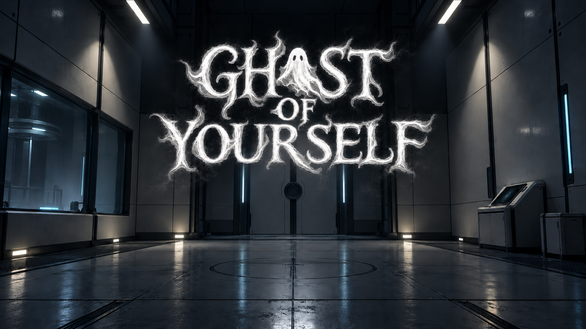

# Ghost of Yourself

**Record your actions. Cooperate with your past self. Escape the lab.**

Ghost of Yourself is a first-person puzzle game built during a 36-hour hackathon
with Unreal Engine and C++. You are a lab subject guided through a series of
experiments by a friendly—but suspicious—robot narrator.

Create ghosts that replay your actions, then work alongside them to solve ten
puzzle rooms. Room 0 introduces the experiment before the puzzles begin.

## Download and play

Visit the [Releases page](https://github.com/glbequette/ghost-of-yourself/releases)
for packaged Windows builds.

1. Download the attached Windows game ZIP, rather than the automatically
   generated source-code archive.
2. Extract the entire ZIP to a folder on your computer.
3. Run `GhostOfYourself.exe`. Keep the accompanying `Engine` and
   `GhostOfYourself` folders beside it.

You do not need Unreal Engine installed to play the packaged game.

## Controls

| Input | Action |
| --- | --- |
| WASD | Move |
| Mouse | Look |
| Space | Jump |
| E | Interact with buttons |
| R | Start recording / save the recording |
| X | Cancel recording / restart the attempt |
| Z | Remove the newest saved ghost |
| Esc | Open the pause menu / continue playing |

The pause menu includes **Continue**, **Settings**, and **Quit**. Settings let you
adjust mouse sensitivity, music volume, narrator volume, and master volume.
Your preferences are saved between launches.

## How the puzzles work

- **Record and replay:** recordings capture your movement and button presses.
  Recording stops automatically after 20 seconds. Ghosts hold their final pose
  when playback reaches the end.
- **Pressure plates:** leave a ghost standing on a plate while you move through
  the gate. Groups of plates require every plate to remain occupied.
- **Buttons:** coordinate presses within a group's timing window. Each button
  can be pressed once per attempt.
- **Security lasers:** use a ghost to block a beam. The segment between the
  emitter and the ghost remains dangerous; cross on the protected side.
- **Multiple ghosts:** each room has its own ghost allowance, displayed on
  screen. When all slots are occupied, a new saved recording replaces the oldest
  ghost. Canceling that recording restores the previous ghost.

Finishing a room clears its ghosts so the next room starts fresh. Entering the
final exit in Room 10 plays the completion narration and returns to the title.

## Built with

- **Unreal Engine 5.8.3** — engine, editor, levels, and rendering.
- **C++ and Blueprints** — recording, playback, puzzles, UI, and character setup.
- **Blender** — custom lab assets, player model, and animations.
- **ElevenLabs** — robot narration.
- **Python** — asset workflows and original synthesized background music.
- **OpenAI Codex and image generation** — AI-assisted development and artwork.

## Open the source project

Playing a release requires only the packaged download. To edit or build the
source, install Unreal Engine 5.8.3 and Visual Studio 2022 with the **Game
development with C++** workload, a Windows SDK, and the **.NET Framework 4.8 SDK**.

1. Clone this repository with [Git LFS](https://git-lfs.com/) installed, and run
   `git lfs pull` to download the binary assets.
2. The Unreal project is `GhostOfYourself/GhostOfYourself.uproject` inside the
   repository. Generate Visual Studio project files from that `.uproject`.
3. Build the `GhostOfYourselfEditor` target in **Development Editor / Win64**.
   Keep Unreal closed while compiling changes to native classes.
4. Open the `.uproject`. `L_Title` is the game's default starting map;
   `L_TestRoom` contains the lab and puzzle rooms.

Use full builds for native class changes. Live Coding caused crashes during
development, so the project was developed with a save, close, build, and reopen
workflow.

## Repository layout

| Folder | Contents |
| --- | --- |
| `GhostOfYourself/Source/GhostOfYourself` | Native gameplay and UI code |
| `GhostOfYourself/Source/GhostOfYourself/Tests` | Unreal automation tests |
| `GhostOfYourself/Content` | Maps, models, materials, Blueprints, and audio |
| `SourceArt` | Source artwork, models, music, and supporting scripts |
| `docs` | Development and editor setup guides |

Some guides describe earlier prototypes; the current C++ implementation is the
reference. In particular, developer room-jump cheats have been removed, and the
title and pause menus use standard clickable UI widgets.

## Testing and packaging

Native tests use the `GhostOfYourself` automation-test prefix. They cover
recording and interpolation, puzzles, ghost replacement, narration, completion,
title buttons, pause settings, and removal of room cheats.

To make a Windows build, save the project and choose **Platforms → Windows →
Package Project**, using **Shipping** for a release. Share the complete packaged
folder as a ZIP attached to a GitHub Release.

## About the project

The central idea is to turn your own past actions into puzzle-solving teammates.
The hackathon build focuses on that mechanic, a cohesive lab atmosphere, and
room designs that combine timing, positioning, and coordination.

Created by [glbequette](https://github.com/glbequette).
